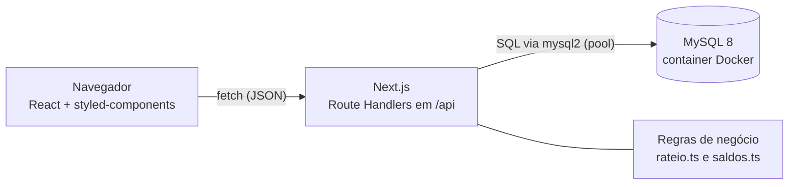
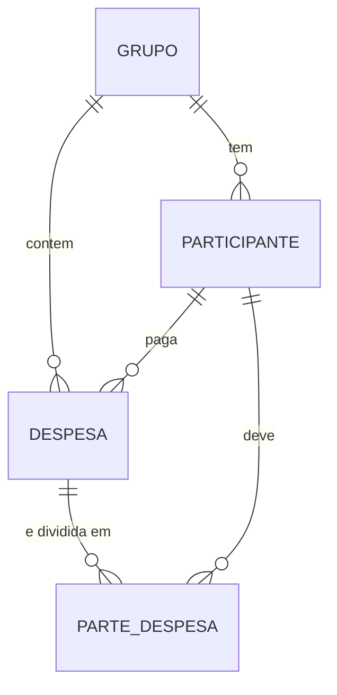

# Split&Go

MVP de uma plataforma para dividir despesas em grupo (viagens, repúblicas, eventos) e calcular, ao final, **quem paga quanto a quem** com poucas transações.

- Quadro de gestão (GitHub Projects): `https://github.com/users/mateuspistillo/projects/1`
- Aplicação publicada: não incluída nesta entrega (item bônus)

## O que o MVP faz

- **Grupos e integrantes:** cria grupos com vários participantes (mínimo de dois), com validação na tela e na API.
- **Despesas flexíveis:** uma despesa é paga por uma pessoa e dividida entre N pessoas, com rateio **igual**, **por porcentagem** ou **por valor fixo**.
- **Lista de despesas** de cada grupo, com a parte de cada participante.
- **Painel de quitação:** mostra o saldo de cada pessoa (quem recebe e quem deve), o **extrato individual** (o que cada um pagou e a sua parte em cada despesa) e o plano de pagamentos que zera todas as contas.

## Stack e por que foi escolhida

| Camada | Escolha | Por quê |
|---|---|---|
| Front e back | **Next.js (App Router) + TypeScript** | Interface e API no mesmo projeto: menos configuração e um único deploy, o que acelera um MVP. O TypeScript pega erros de tipo antes de rodar, útil em cálculos com dinheiro. |
| Interface | **React + styled-components** | Componentes pequenos com o estilo junto de cada um. |
| Banco | **MySQL 8** | Os dados são relacionais (grupo → participantes → despesas → partes), e as chaves estrangeiras garantem a integridade. |
| Acesso ao banco | **mysql2 com SQL escrito à mão e pool de conexões** | Transparente e fácil de explicar. Para um modelo pequeno, evita a curva de um ORM. |
| Infraestrutura local | **Docker Compose** | Quem clonar o repositório sobe o banco com um comando, com volume para os dados sobreviverem ao reinício. |
| Segredos | **Variáveis de ambiente (`.env.local`)** | A senha do banco não vai para o repositório. |
| Gestão | **GitHub Projects + Conventional Commits** | Cards com critérios de aceite, ligados aos commits pelo número da issue. |

## Arquitetura



**Fluxo de uma despesa:**

1. A tela envia a despesa (descrição, valor em centavos, pagador, tipo de rateio e participantes) em JSON para `POST /api/despesas`.
2. A API busca no banco quem pertence ao grupo e valida o pedido.
3. As funções de rateio calculam a parte de cada pessoa, e a soma das partes é conferida contra o total.
4. A despesa e as partes são gravadas **em uma transação**: ou grava tudo, ou nada.
5. O painel de quitação lê tudo de novo por `GET /api/liquidacao`, calcula os saldos e aplica o algoritmo de simplificação.

A validação existe na tela, para resposta imediata, e na API, que é quem protege de verdade, porque qualquer pedido pode chegar sem passar pela tela.

### Infraestrutura sugerida para produção

| Peça | Sugestão | Observação |
|---|---|---|
| Hosting da aplicação | Plataforma serverless para Next.js (por exemplo, Vercel) ou container (Railway, Fly.io) | Deploy a cada push, sem gerenciar servidor. |
| Banco de dados | MySQL gerenciado (por exemplo, AWS RDS ou serviço equivalente) com backup automático | Mesmo SQL do ambiente local. |
| Segredos | Variáveis de ambiente do provedor de hosting | Nunca no código. |
| Filas | **Não são necessárias no MVP.** Na V2, uma fila para notificações e para atualizar cotações de moeda | O cálculo de saldos é rápido e síncrono para grupos pequenos. |

## Modelo de dados



- Todos os valores são guardados em **centavos, como inteiros**, o que evita erros de arredondamento de números decimais.
- `parte_despesa` guarda a parte de cada pessoa em cada despesa e tem uma restrição de unicidade por (despesa, participante).
- Apagar um grupo apaga seus participantes e despesas (`ON DELETE CASCADE`).

## API

| Método e rota | Função |
|---|---|
| `GET /api/grupos` | Lista os grupos com seus participantes |
| `POST /api/grupos` | Cria um grupo (nome e lista de participantes) |
| `GET /api/despesas?grupoId=` | Lista as despesas de um grupo, com as partes |
| `POST /api/despesas` | Lança uma despesa, calcula o rateio e grava tudo em uma transação |
| `GET /api/liquidacao?grupoId=` | Devolve saldos, a soma dos saldos (deve ser 0) e o plano de pagamentos |

## Como o saldo e a simplificação funcionam

1. **Saldo de cada pessoa** = o que ela pagou − a soma das partes que ela deve. Positivo: tem a receber. Negativo: tem a pagar. A soma dos saldos de um grupo é sempre zero, e a API devolve essa soma como verificação.
2. **Simplificação (algoritmo guloso):** enquanto houver alguém com saldo positivo e alguém com saldo negativo, o maior devedor paga ao maior credor o **menor** entre o que um deve e o outro tem a receber. A cada pagamento, pelo menos uma das duas pessoas zera.
3. **Resultado:** no máximo N−1 pagamentos para N pessoas com saldo pendente. Exemplo: se A deve 50 a B e B deve 50 a C, o saldo de B é zero e o sistema sugere que A pague 50 direto a C.

Limitação conhecida: o guloso é rápido e garante o teto de N−1, mas **não garante o mínimo absoluto** em todos os casos (achar o mínimo exato é um problema bem mais difícil). Para o MVP, é uma troca consciente de simplicidade por otimalidade.

## Como rodar localmente

Pré-requisitos: Node.js 20 ou superior, Git e Docker Desktop (aberto).

```bash
git clone https://github.com/mateuspistillo/split-and-go.git
cd split-and-go
npm install
docker compose up -d
```

Crie o arquivo `.env.local` na raiz, com:

```
DB_HOST=localhost
DB_PORT=3307
DB_USER=root
DB_PASSWORD=conexao123
DB_NAME=splitandgo
```

Espere cerca de 30 segundos para o MySQL terminar de iniciar e crie as tabelas:

```bash
# Linux e macOS
docker compose exec -T db mysql -u root -pconexao123 splitandgo < db/init.sql
```

```powershell
# Windows (PowerShell)
Get-Content db/init.sql | docker compose exec -T db mysql -u root -pconexao123 splitandgo
```

Por fim:

```bash
npm run dev
```

e abra `http://localhost:3000`. A senha acima é de desenvolvimento local, e não deve ser usada em produção.

## Análise de edge cases

| Cenário | Como a aplicação lida |
|---|---|
| **Divisão que não é exata:** R$ 100,00 entre 3 pessoas (33,333...) | Os valores são centavos inteiros. A base de cada parte é o quociente inteiro, e os centavos que sobram vão de um em um às primeiras pessoas (3334, 3333, 3333). A soma bate sempre com o total. |
| **Porcentagens que geram frações de centavo** | Cada parte é calculada com a porcentagem, arredondada para baixo, e os centavos restantes vão para quem tem o **maior resto** fracionário (método do maior resto). A soma das partes continua igual ao total. |
| **Porcentagens que não somam 100%, ou valores fixos que não somam o total** | A API recusa o pedido com erro 400 e uma mensagem clara. Nada é gravado. |
| **Valor zero, negativo ou fracionado** | Recusado: o valor precisa ser um inteiro positivo de centavos. |
| **Pagador ou participante fora do grupo, ou participante repetido** | A API confere a lista de membros do grupo no banco e recusa. |
| **Falha no meio da gravação** | A despesa e suas partes são gravadas em uma transação: se algo falhar, nada fica gravado e não sobra despesa sem partes. |
| **Pagador que não participa da divisão** | Funciona: o saldo é calculado como o que a pessoa pagou menos o que ela deve, então ela fica com saldo positivo igual ao que adiantou. |
| **Grupo sem despesas, ou com todos quites** | O plano de pagamentos volta vazio, e a tela mostra uma mensagem de que não há nada a acertar. |
| **Moedas diferentes** | **Não suportado no MVP:** cada instalação opera em uma única moeda (reais). É uma decisão de escopo, e a evolução está descrita abaixo. Como tudo é guardado em centavos de uma moeda só, não existe mistura de moedas nos saldos. |

## Evolução de produto (V2)

1. **Múltiplas moedas com cotação congelada.** Cada despesa guardaria a moeda, a cotação do dia e o valor convertido para a moeda do grupo, para que a dívida não mude quando a cotação variar. *Impacto:* abre o produto para viagens internacionais, o caso de uso em que o rateio mais dói, e amplia o mercado.
2. **Contas de usuário e convite por link.** Cada pessoa entra no grupo por um link, vê só os seus grupos e lança despesas do próprio celular. *Impacto:* hoje uma pessoa digita tudo por todo mundo. Com convites, o grupo inteiro participa, o que aumenta a retenção e o crescimento orgânico.
3. **Quitação integrada com PIX e confirmação.** O plano de pagamentos geraria o pagamento (QR Code ou copia e cola), e o recebedor confirmaria o recebimento, marcando a dívida como quitada. *Impacto:* fecha o ciclo do produto (calcular e pagar), reduz a fricção e abre espaço para monetização, por exemplo com um plano premium ou parcerias de pagamento.

## Gestão do projeto

- **Quadro:** GitHub Projects com as colunas Backlog, In Progress, In Review/Testing e Done. Cada card tem critérios de aceite ("Pronto quando") e uma lista de tarefas.
- **Commits:** padrão Conventional Commits (`feat`, `fix`, `chore`, `refactor`, `docs`), em passos pequenos, cada um ligado ao card pelo número da issue (por exemplo, `feat: salva grupo e participantes no banco ao cadastrar (#1)`).

## Limitações conhecidas e próximos passos

- A criação de grupo grava o grupo e depois cada participante, **sem transação**: uma falha no meio pode deixar um grupo sem participantes. A despesa já usa transação, e o mesmo ajuste cabe ao grupo.
- O styled-components ainda não tem a configuração de SSR do Next (o registry), o que gera um aviso de hidratação no ambiente de desenvolvimento.
- Não há testes automatizados do algoritmo e das funções de rateio. A soma dos saldos retornada pela API serve como verificação manual.
- Porcentagens como 33,33% três vezes somam 99,99% e são recusadas: é preciso ajustar uma delas (por exemplo, 33,34%).
- Dois participantes com o mesmo nome no mesmo grupo são aceitos.
- Não há autenticação, extrato individual nem aplicação publicada.
